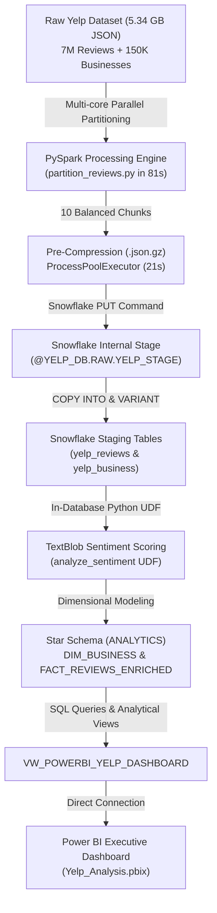
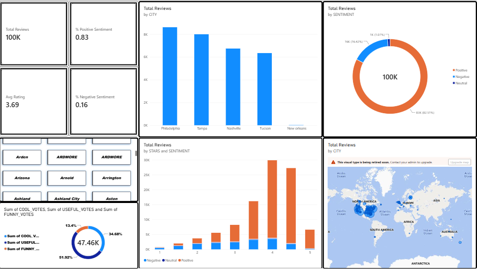

# 🍽️ End-to-End Yelp Big Data Analytics & Sentiment Pipeline

[](https://www.python.org/)
[](https://spark.apache.org/)
[](https://www.snowflake.com/)
[](https://textblob.readthedocs.io/)
[](https://powerbi.microsoft.com/)

An enterprise-grade, end-to-end Big Data Engineering and Analytics pipeline built on the **Yelp Open Academic Dataset** (**5.34 GB JSON, 7 Million reviews, 150K businesses**). 

The project demonstrates high-throughput distributed preprocessing with **PySpark**, cloud warehousing and native **in-database NLP sentiment analysis** via **Snowflake Python UDFs**, **Star Schema dimensional modeling**, and an interactive executive **Power BI dashboard**.

---

## 🏗️ Architecture & Pipeline Flow



---

## 📊 Power BI Dashboard Preview

The final dashboard provides deep business intelligence, sentiment polarity breakdown, city satisfaction benchmarking, and ratings correlation:



---

## ⚡ Key Highlights & Engineering Milestones

1. **Distributed Big Data Preprocessing (PySpark)**:
   * Sliced a monolithic **5.34 GB raw JSON file (6,990,280 reviews)** into 10 balanced partitions.
   * Leveraged **18 parallel CPU worker threads** via `.master("local[*]")`, completing execution in just **81.72 seconds**.
2. **Optimized Cloud Staging (Snowflake Internal Stage)**:
   * Bypassed external cloud bucket overhead (AWS S3) by utilizing **Snowflake Internal Staging** (`PUT`).
   * Pre-compressed raw JSON chunks using Python's **`ProcessPoolExecutor`**, reducing data volume by **60% (from 5.34 GB to 2.13 GB)** in 21 seconds.
3. **High-Speed Ingestion (`VARIANT` & `COPY INTO`)**:
   * Ingested **150,346 businesses in 5.92 seconds**.
   * Ingested **6,990,280 reviews in 17.79 seconds**.
4. **In-Database Machine Learning (Python UDF with TextBlob)**:
   * Deployed a native Python 3.10 UDF directly inside Snowflake compute nodes.
   * Classified **100,000+ reviews** into *Positive*, *Neutral*, and *Negative* sentiment categories in 62 seconds without exporting data outside the warehouse.
5. **Star Schema Dimensional Modeling**:
   * Flattened semi-structured `VARIANT` JSON into **`DIM_BUSINESS`** and **`FACT_REVIEWS_ENRICHED`**.
6. **Executive Business Analytics & Power BI**:
   * Authored complex analytical queries uncovering critical insights (e.g. 40% positive sentiment discrepancies in 1-star reviews due to sarcasm).
   * Built a unified semantic view (`VW_POWERBI_YELP_DASHBOARD`) connected to Power BI Desktop.

---

## 🔍 Key Business Findings (SQL Analytics)

### 1. Star Rating vs. Sentiment Correlation

| Stars | Total Reviews | Positive | % Positive | Negative | % Negative | Neutral |
| :---: | :---: | :---: | :---: | :---: | :---: | :---: |
| **5 ⭐** | 51,574 | 50,614 | **98.1%** | 726 | 1.4% | 234 |
| **4 ⭐** | 13,806 | 13,340 | **96.6%** | 426 | 3.1% | 40 |
| **3 ⭐** | 7,172 | 6,088 | **84.9%** | 1,037 | 14.5% | 47 |
| **2 ⭐** | 6,554 | 4,138 | **63.1%** | 2,340 | 35.7% | 76 |
| **1 ⭐** | 20,894 | 8,332 | **39.9%** | 11,891 | **56.9%** | 671 |

> **Business Insight**: While 5-star ratings strongly align with positive NLP sentiment (98.1%), nearly **40% of 1-star reviews contain positive words**. Text inspection revealed heavy use of **sarcasm** (*"I heard so many great things..."*) or customers complimenting staff before detailing severe management/operational complaints.

---

### 2. Geographical Benchmark: Top 10 Cities

| City | State | Total Reviews | Avg Stars | % Positive Sentiment | % Negative Sentiment |
| :--- | :---: | :---: | :---: | :---: | :---: |
| **Santa Barbara** | CA | 3,751 | **4.03** | **88.2%** | **10.6%** *(Highest Satisfaction)* |
| **New Orleans** | LA | 7,291 | **3.98** | **87.7%** | 11.2% |
| **Indianapolis** | IN | 5,597 | **3.88** | 85.2% | 13.8% |
| **Saint Louis** | MO | 2,479 | **3.81** | 84.2% | 14.9% |
| **Philadelphia** | PA | 8,618 | **3.79** | 84.6% | 14.5% |
| **Nashville** | TN | 6,743 | **3.75** | 83.7% | 15.3% |
| **Reno** | NV | 5,749 | **3.65** | 82.5% | 16.5% |
| **Tampa** | FL | 7,994 | **3.64** | 82.1% | 16.9% |
| **Boise** | ID | 1,606 | **3.63** | 83.1% | 15.3% |
| **Tucson** | AZ | 6,346 | **3.54** | **80.0%** | **18.6%** *(Most Critical)* |

---

## 📂 Repository Structure

```text
Yelp_Analysis/
├── .env.example                   # Template for Snowflake credentials
├── .gitignore                     # Ignores large raw datasets & secrets
├── requirements.txt               # Python package dependencies
├── README.md                      # Comprehensive project documentation
│
├── partition_reviews.py           # PySpark script: parallel multi-core partitioning
├── rename_splits.py               # Helper script: cleans up partition filenames
├── full_upload.py                 # Multi-core pre-compression & Snowflake PUT staging
├── ingest_data.py                 # Snowflake COPY INTO & VARIANT landing tables
├── create_analytics_models.py     # Deploys Python UDF & Star Schema tables
├── run_business_analytics.py      # Executes SQL business queries & creates Power BI view
├── yelp_analytics_queries.sql     # Standalone SQL queries for Snowflake Worksheets
│
└── Power_Bi_report/
    ├── Yelp_Analysis.pbix         # Interactive Power BI Report file
    └── Power_Bi.png               # Dashboard screenshot
```

---

## 🚀 How to Run the Pipeline

### 1. Clone the Repository & Install Dependencies
```bash
git clone https://github.com/Ansh3105/Yelp_Analysis.git
cd Yelp_Analysis
pip install -r requirements.txt
```

### 2. Configure Snowflake Credentials
Copy `.env.example` to `.env` and fill in your Snowflake credentials:
```env
SNOWFLAKE_ACCOUNT=your_account_identifier
SNOWFLAKE_USER=your_username
SNOWFLAKE_PASSWORD=your_password
SNOWFLAKE_ROLE=ACCOUNTADMIN
SNOWFLAKE_WAREHOUSE=YELP_WH
SNOWFLAKE_DATABASE=YELP_DB
SNOWFLAKE_SCHEMA=RAW
```

### 3. Execute Pipeline Chronologically
```bash
# Step 1: Partition raw 5.34 GB reviews with PySpark
python partition_reviews.py
python rename_splits.py

# Step 2: Pre-compress and stage files in Snowflake
python full_upload.py

# Step 3: Ingest data into Snowflake VARIANT tables
python ingest_data.py

# Step 4: Deploy Python Sentiment UDF and build Star Schema
python create_analytics_models.py

# Step 5: Run analytical business queries and create Power BI view
python run_business_analytics.py
```

### 4. Connect Power BI
1. Open **Power BI Desktop**.
2. Select **Get Data** $\rightarrow$ **Snowflake**.
3. Connect to database `YELP_DB` $\rightarrow$ Schema `ANALYTICS`.
4. Import `DIM_BUSINESS` and `FACT_REVIEWS_ENRICHED` (or `VW_POWERBI_YELP_DASHBOARD`).

---

## 👤 Author
* **Ansh Singh** - [GitHub](https://github.com/Ansh3105)
